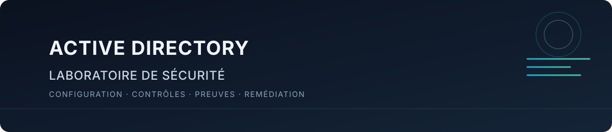
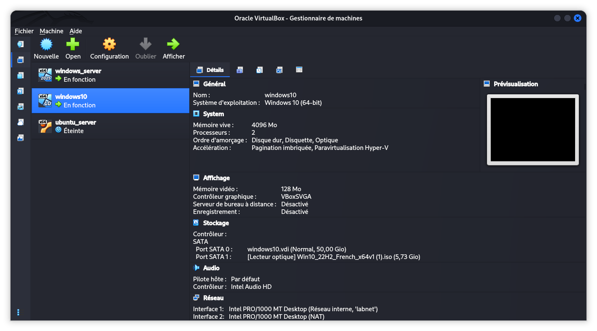

  

# Laboratoire de sécurité Active Directory

Documentation d’un laboratoire virtualisé consacré à la mise en place, à la sécurisation et à l’audit d’un domaine Active Directory. Le dépôt décrit un seul environnement de laboratoire, organisé en huit étapes documentaires ; il ne prétend pas représenter plusieurs projets indépendants.

> **État du projet :** laboratoire documenté, avec vérifications à reprendre. Une capture de `dcdiag` montre un échec du test initial de connectivité lié à la résolution DNS du contrôleur. Les résultats d’audit et les vulnérabilités ne sont donc pas déclarés comme complets ou confirmés.

## Sommaire

- [Présentation](#présentation)
- [Objectifs](#objectifs)
- [Technologies et environnement](#technologies-et-environnement)
- [Navigation dans le laboratoire](#navigation-dans-le-laboratoire)
- [État d’avancement](#état-davancement)
- [Aperçu de l’environnement](#aperçu-de-lenvironnement)
- [Compétences travaillées](#compétences-travaillées)
- [Règles de sécurité](#règles-de-sécurité)
- [Limites et contributions](#limites-et-contributions)

## Présentation

Le projet documente un domaine de test `lab.local` exploité dans Oracle VirtualBox. Les procédures couvrent AD DS, les unités d’organisation, les groupes et comptes, les permissions SMB/NTFS, les stratégies de groupe, DNSSEC, puis le processus d’audit et de remédiation. Les captures sont des éléments de preuve ponctuels ; lorsqu’elles contredisent le texte ou ne suffisent pas à confirmer une configuration, cette limite est indiquée dans la documentation.

## Objectifs

- Déployer et comprendre les composants d’un domaine Active Directory.
- Organiser les identités et les autorisations selon le moindre privilège.
- Configurer et vérifier les contrôles de sécurité Windows et DNS.
- Distinguer une configuration déclarée d’un résultat effectivement vérifié.
- Documenter les écarts observés et leur validation sans inventer de constats.

## Technologies et environnement

| Composant | État documenté |
|---|---|
| Hyperviseur | Oracle VirtualBox |
| Hôte d’administration | Kali Linux |
| Contrôleur de domaine | `SRV-DC01`, Windows Server 2025 Datacenter Evaluation, version 24H2 visible sur capture |
| Domaine et DNS | AD DS et DNS pour `lab.local` |
| Poste client | `CLIENT-W10`, Windows 10 |
| Réseaux VirtualBox | Une interface `Internal Network` nommée `labnet` et une interface NAT apparaissent dans les captures |
| VM Ubuntu | Présente dans l’inventaire VirtualBox, arrêtée sur la capture ; rôle et connectivité non vérifiés |

Les éléments visibles dans les captures ne garantissent pas que le domaine ou les chemins réseau sont actuellement opérationnels. Voir le [diagnostic d’architecture](docs/01-architecture/architecture.md) et les [résultats d’audit](docs/07-security-audit/audit-results.md).

## Navigation dans le laboratoire

La [page d’accueil du laboratoire](docs/README.md) donne accès aux étapes et à leur état de preuve.

| Étape | Sujet | Documentation |
|---|---|---|
| 01 | Architecture et réseau | [Architecture](docs/01-architecture/architecture.md) |
| 02 | Installation AD DS | [Installation du domaine](docs/02-active-directory/adds-installation.md) |
| 03 | Identités et groupes | [Utilisateurs](docs/03-identity-management/user-management.md) · [Groupes](docs/03-identity-management/security-groups.md) · [OU](docs/03-identity-management/organizational-units.md) |
| 04 | Partages et contrôle d’accès | [Partage réseau](docs/04-access-control/shared-folders.md) · [Tests d’accès](docs/04-access-control/permissions-testing.md) |
| 05 | Durcissement Windows | [GPO](docs/05-system-hardening/gpo-implementation.md) · [Serveur Windows](docs/05-system-hardening/windows-server-hardening.md) |
| 06 | DNSSEC | [Mise en œuvre et limites](docs/06-dns-security/dnssec-implementation.md) |
| 07 | Audit | [Méthodologie](docs/07-security-audit/audit-methodology.md) · [Résultats](docs/07-security-audit/audit-results.md) · [Constats](docs/07-security-audit/security-findings.md) |
| 08 | Remédiation | [Plan de remédiation](docs/08-remediation/remediation-plan.md) |

Les scripts, configurations et résultats bruts ne sont pas encore fournis comme fichiers exécutables ou exports dans ce dépôt. Voir [scripts/README.md](scripts/README.md).

## État d’avancement

| Domaine | État |
|---|---|
| Architecture | Interfaces VirtualBox documentées ; connectivité du contrôleur à revalider après l’échec `dcdiag` observé. |
| AD DS et DNS | Domaine visible dans les captures ; diagnostic de connectivité/DNS non concluant. |
| Identités et groupes | OU visibles ; certaines captures montrent des objets dans le conteneur par défaut `Users`, à réconcilier avec la structure annoncée. |
| Partage et permissions | Captures de refus et d’accès réussi disponibles ; l’ACL NTFS affichée doit être revue par rapport au moindre privilège. |
| GPO | Captures des paramètres et d’un verrouillage disponibles ; intervalle de réinitialisation affiché : 14 minutes. Portée appliquée à revalider. |
| DNSSEC | Paramètre de validation DNSSEC distant et enregistrements signés visibles ; validation cryptographique des clients et chaîne de confiance interne non démontrées. |
| Audit / remédiation | Audit incomplet ; aucun constat de vulnérabilité confirmé dans le registre. Un échec opérationnel DNS/DC locator est documenté pour investigation. |

## Aperçu de l’environnement

La capture suivante montre les VMs enregistrées dans VirtualBox. Ubuntu est arrêtée sur cette capture ; le schéma logique et les limites de connectivité sont détaillés dans la [documentation d’architecture](docs/01-architecture/architecture.md).

  
Afficher la capture de l’inventaire VirtualBox

  

    
  

## Compétences travaillées

- Administration Windows Server et AD DS.
- Modélisation des OU, identités et groupes de sécurité.
- Analyse des permissions de partage SMB et des ACL NTFS.
- Configuration GPO et validation de politiques de compte.
- Notions de DNSSEC : signature, validation et chaîne de confiance.
- Documentation technique, collecte de preuves et suivi de remédiation.

## Règles de sécurité

- Utiliser les procédures uniquement dans le laboratoire autorisé et isolé.
- Ne pas publier de mots de passe, secrets, clés privées, jetons ou exports sensibles.
- Ne pas interpréter une capture isolée comme preuve d’un état courant.
- Ne réaliser aucun test actif ou susceptible de verrouiller des comptes sans autorisation explicite, fenêtre de test et compte dédié.
- Conserver les résultats, horodatages et limites de test ; séparer les observations des vulnérabilités confirmées.

## Limites et contributions

Le fichier [LICENSE](LICENSE) est actuellement vide : les conditions de réutilisation ne sont pas définies. Aucun type de licence n’est choisi dans ce travail. Les répertoires locaux `configs/` et `audit-reports/` ne contiennent aucun fichier suivi par Git ; ils ne sont donc pas présentés comme des livrables disponibles.

