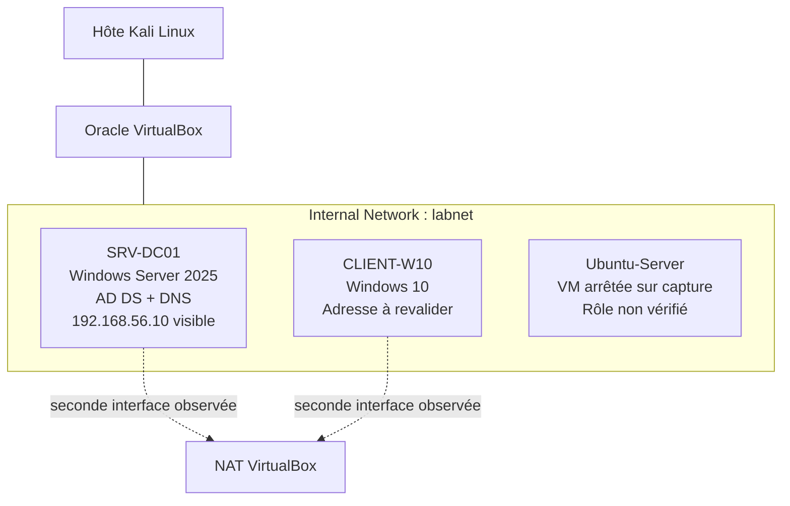
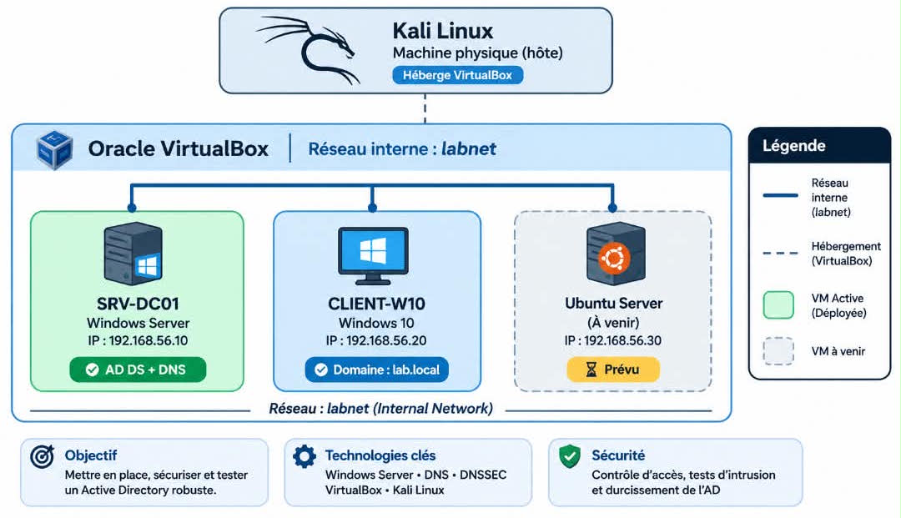
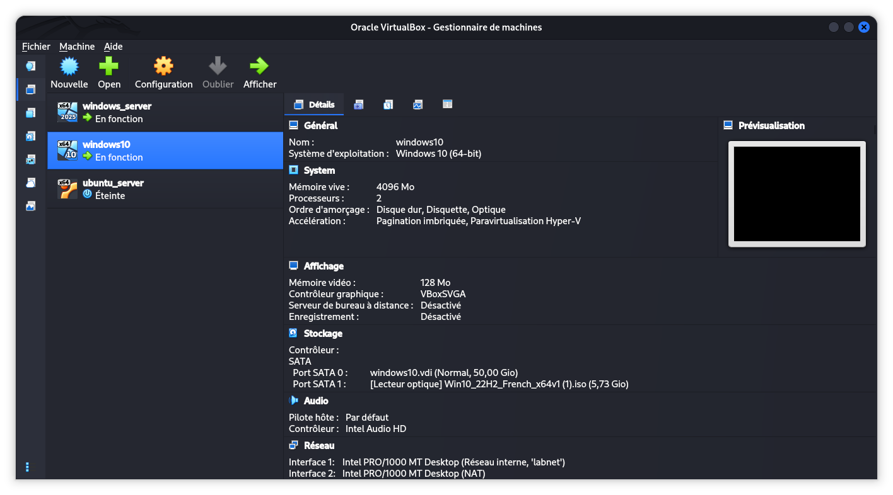
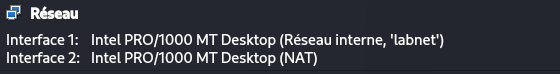
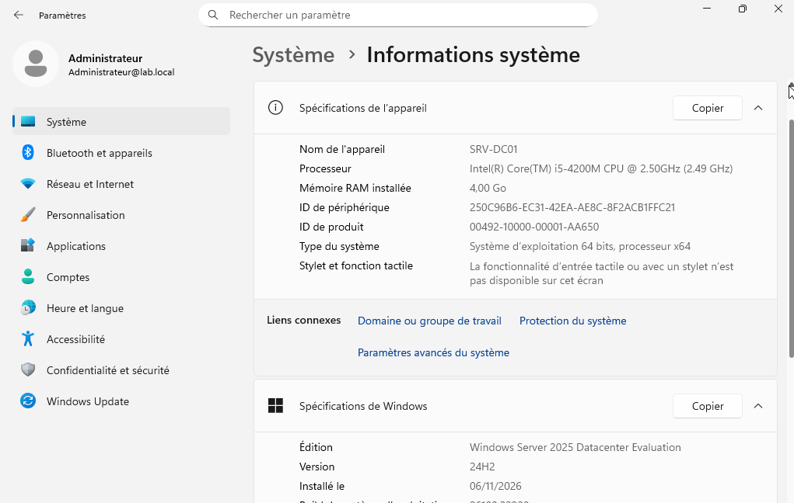
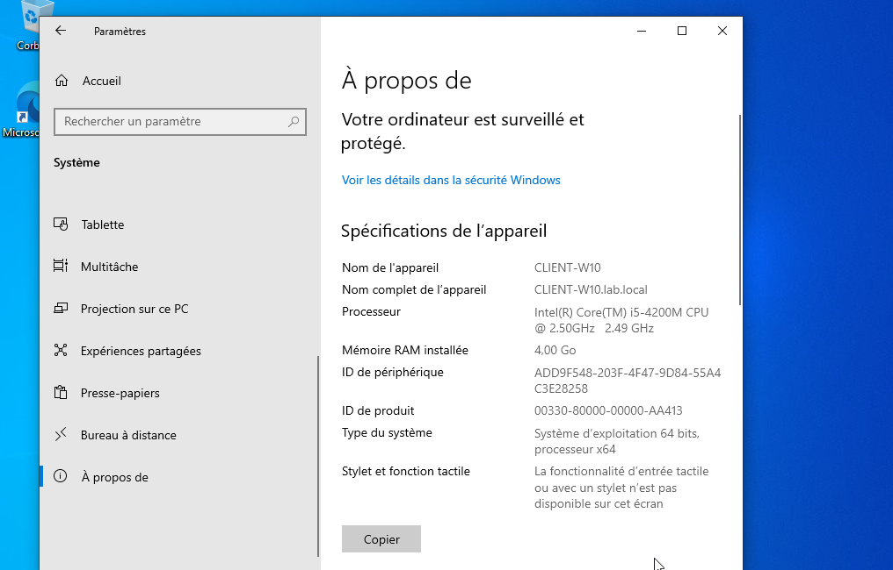
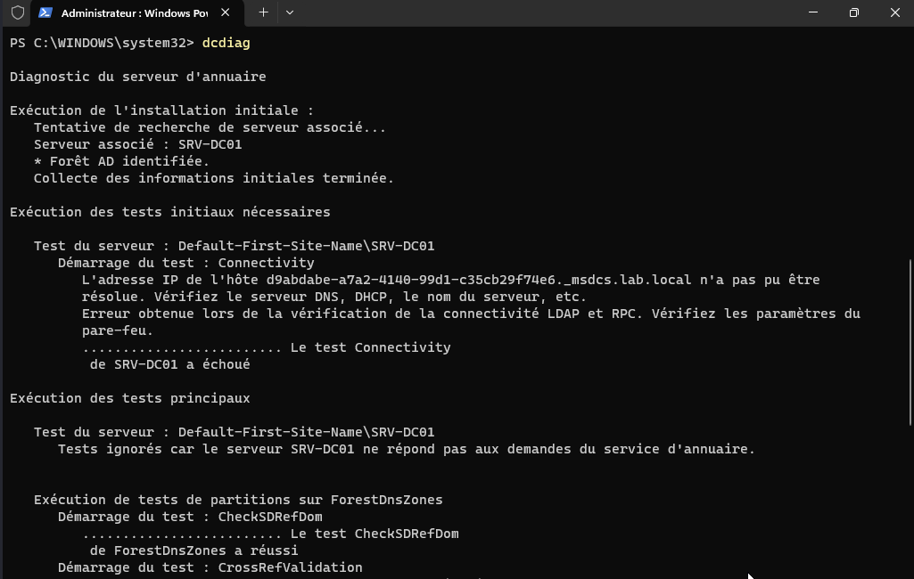

# Architecture de l'infrastructure

[Accueil du laboratoire](../README.md) · [Accueil du dépôt](../../README.md)

## 1. Objectif

Décrire l’environnement VirtualBox, les machines connues et les éléments de réseau visibles dans les preuves du laboratoire TechCorp.

## 2. Contexte technique

Les notes identifient Kali Linux comme hôte d’administration et Oracle VirtualBox comme hyperviseur. Les captures montrent des interfaces attachées à un réseau interne `labnet` et au NAT. Ces éléments ne prouvent pas à eux seuls que l’hôte Kali ou toutes les VMs peuvent communiquer entre eux.

## 3. Machines et état des preuves

| Machine | Système / rôle | État vérifiable |
|---|---|---|
| `SRV-DC01` | Windows Server 2025 Datacenter Evaluation, version 24H2 visible sur capture ; AD DS et DNS | Capture système disponible ; adresse `192.168.56.10` visible. Un test de connectivité `dcdiag` échoue, voir ci-dessous. |
| `CLIENT-W10` | Windows 10 ; client de `lab.local` selon les notes et captures | Capture système disponible. Son adresse IP et l’accès courant au contrôleur restent à revalider. |
| `Ubuntu-Server` | VM Ubuntu présente dans l’inventaire VirtualBox | La capture montre la VM arrêtée ; rôle et réseau non vérifiés. |

Une capture des paramètres VirtualBox montre deux interfaces sur les VMs Windows : `Internal Network (labnet)` et NAT. La capture IP du contrôleur montre `192.168.56.10/24` et un DNS préféré `127.0.0.1`. La communication de Kali avec le réseau interne n’est pas démontrée.

## 4. Schéma logique

Le schéma raster historique est conservé comme illustration conceptuelle, non comme source de vérité pour l’état des VMs ou des adresses :

## 5. Vérifications et limites observées

La capture `dcdiag` consignée comme état du contrôleur montre un échec au test initial de connectivité : un nom GUID sous `_msdcs.lab.local` ne peut pas être résolu. Une autre capture de la zone DNS montre pour `SRV-DC01` les adresses `192.168.56.10` et `10.0.3.15`. La seconde adresse doit être corrélée avec les interfaces et la réponse réellement reçue par le client.

Les notes indiquent que des tests de ping et de résolution ont été réalisés, mais aucune sortie datée n’est fournie. Ces contrôles sont à rejouer avant de déclarer l’environnement pleinement opérationnel.

## 6. Captures d'écran

**Figure 1 — Inventaire VirtualBox ; Ubuntu apparaît arrêtée**

**Figure 2 — Interfaces configurées sur la VM**

**Figure 3 — Informations système du serveur `SRV-DC01`**

**Figure 4 — Informations système du client `CLIENT-W10`**

**Figure 5 — Échec du test initial de connectivité dans `dcdiag`**

## 7. Résultat et statut

**Partiellement documenté, connectivité à revalider.** Les captures prouvent la présence des VMs Windows et les interfaces configurées ; elles ne prouvent pas la connectivité complète. L’échec observé dans `dcdiag` et les enregistrements DNS multihomés doivent être investigués avant toute conclusion sur l’état du domaine.

Lors de la configuration initiale, un problème d’ordre d’amorçage de la VM Windows 10 est rapporté comme résolu en modifiant l’ordre de démarrage et en retirant le lecteur optique virtuel. Cette difficulté est issue des notes du laboratoire.

## 8. Conclusion

L’environnement documenté fournit une base de laboratoire, mais la disponibilité des services doit être confirmée par des tests reproductibles. Ne pas considérer les adresses du schéma historique ou l’état « en fonction » d’une VM comme preuve de résolution DNS ou de connectivité entre hôtes.

[Installation AD DS](../02-active-directory/adds-installation.md) · [Retour à l’index](../README.md)