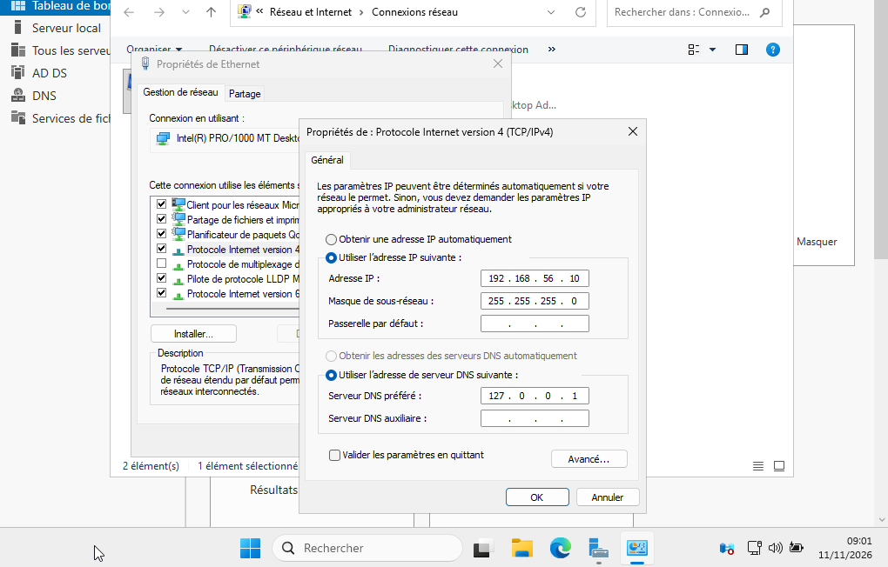
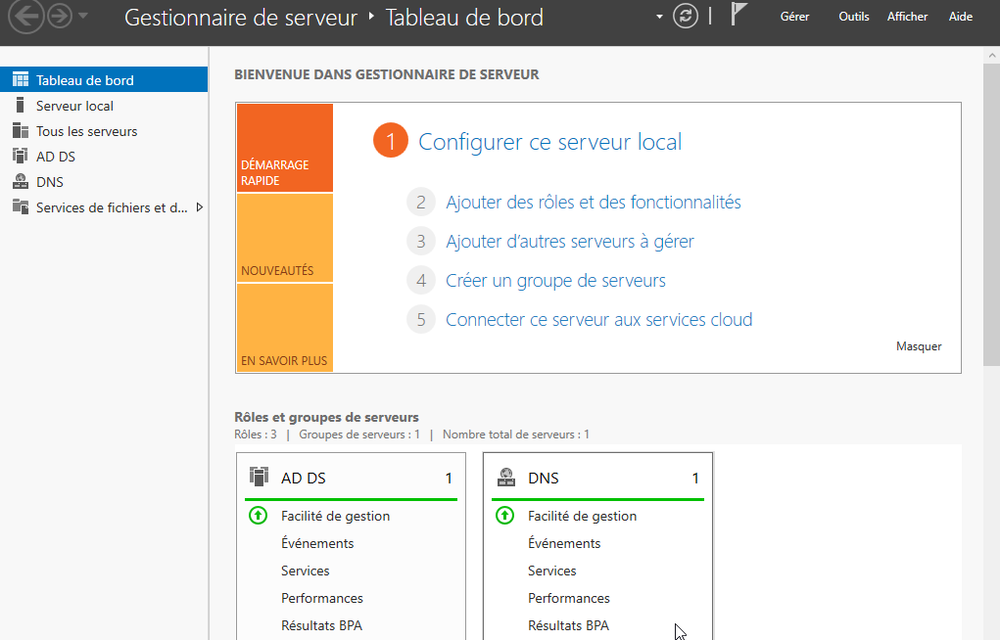
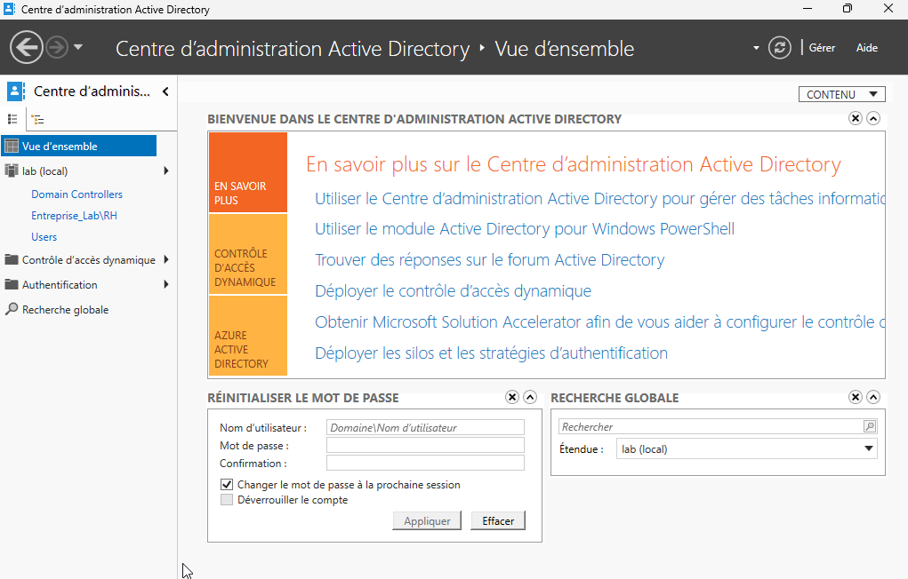
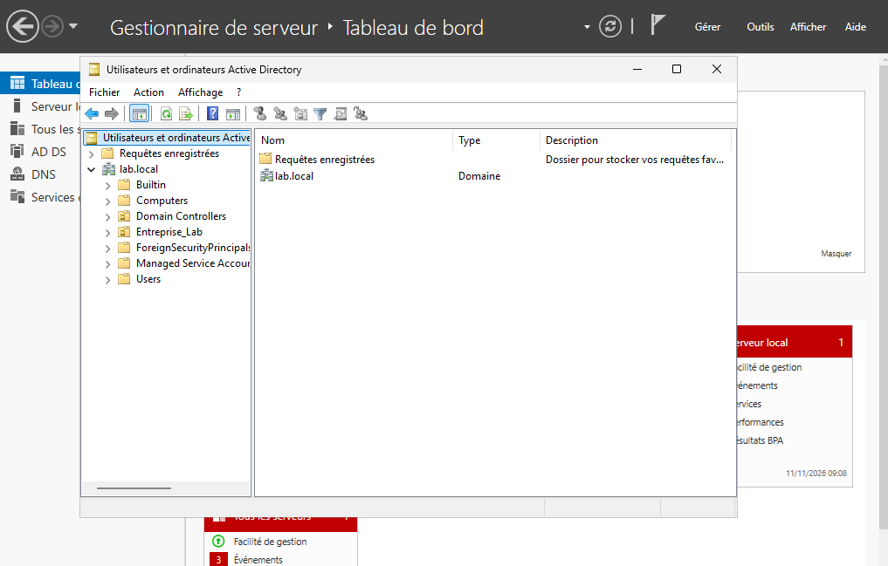
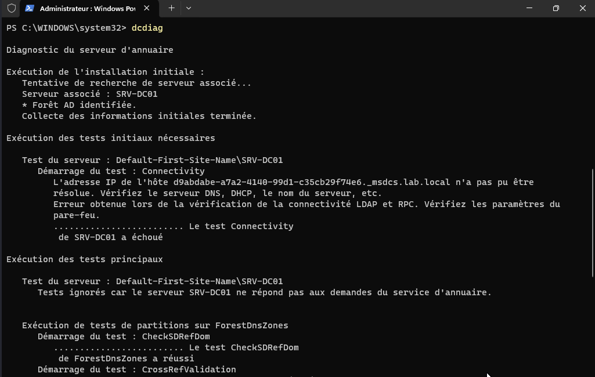

# Installation et configuration d'Active Directory (AD DS)

[Accueil du laboratoire](../README.md) · [Accueil du dépôt](../../README.md)

## 1. Objectif

Ce document décrit la procédure d'installation du rôle **Active Directory Domain Services (AD DS)** sur le serveur `SRV-DC01`, ainsi que la promotion de ce serveur en tant que contrôleur de domaine pour le domaine `lab.local`.

## 2. Contexte technique

L'installation est documentée sur la VM `SRV-DC01`. Les captures montrent Windows Server 2025 Datacenter Evaluation, version 24H2, l’adresse IPv4 `192.168.56.10` et le DNS préféré `127.0.0.1`. Elles ne suffisent pas à confirmer l’état actuel de tous les services du domaine.

## 3. Configuration réalisée

*   **Rôle installé** : Active Directory Domain Services (AD DS).
*   **Nom du domaine** : `lab.local`.
*   **Type de déploiement** : Création d'une nouvelle forêt.
*   **Niveau fonctionnel de la forêt et du domaine** : non documenté dans les preuves disponibles ; à relever sur le contrôleur.
*   **Serveur DNS** : Installé et configuré automatiquement lors de la promotion (intégré à l'AD).
*   **Base de données et journaux** : emplacements par défaut rapportés dans les notes, non vérifiés par capture.

## 4. Procédure

1. Ouverture du **Gestionnaire de serveur**.
2. Ajout du rôle **Services de domaine Active Directory**.
3. Lancement de l'assistant de promotion du serveur en contrôleur de domaine.
4. Sélection de l'option "Ajouter une nouvelle forêt" et saisie du nom de domaine racine : `lab.local`.
5. Définition du mot de passe du mode de restauration des services d'annuaire (DSRM).
6. Vérification des prérequis et lancement de l'installation.
7. Redémarrage automatique du serveur une fois l'installation terminée.

## 5. Vérifications et état des preuves

Les captures montrent le domaine `lab.local` dans les outils d’administration et le rôle AD DS/DNS installé. Le document original rapporte également une vérification par `Get-ADDomain`, mais sa sortie n’est pas archivée.

À l’inverse, la capture `dcdiag` montre un échec du test initial de connectivité : un enregistrement de contrôleur sous `_msdcs.lab.local` n’a pas pu être résolu. Le fonctionnement DNS/DC locator n’est donc pas considéré comme validé. Voir le [diagnostic d’architecture](../01-architecture/architecture.md) et les [résultats d’audit](../07-security-audit/audit-results.md).

Pour reprendre la validation depuis le contrôleur, archiver les sorties datées des commandes suivantes :

```powershell
Get-ADDomain
dcdiag /test:dns /v
```

## 6. Captures d'écran

**Figure 1 — Configuration IP du serveur `SRV-DC01`**


**Figure 2 — État du déploiement AD DS dans le Gestionnaire de serveur**


**Figure 3 — Assistant de configuration du déploiement**


**Figure 4 — Confirmation de la création du domaine `lab.local`**


**Figure 5 — État du contrôleur de domaine**


## 7. Résultat obtenu

Les captures documentent la promotion de `SRV-DC01` et la présence du domaine `lab.local`. La capture `dcdiag` révèle toutefois un contrôle DNS/DC locator non concluant. La promotion est documentée, mais l’état opérationnel complet du domaine reste à confirmer après correction ou explication de cet échec.

## 8. Difficultés rencontrées

Aucune difficulté majeure lors de l'installation du rôle. Cependant, il a été nécessaire de s'assurer que le DNS pointait bien vers le serveur lui-même avant la promotion pour éviter des erreurs de résolution.

## 9. Conclusion

Le déploiement d'AD DS est une étape fondamentale. Il permet de centraliser la gestion des identités et de fournir la base de l'infrastructure de sécurité du laboratoire TechCorp.

[Étape suivante : organisation des OU](../03-identity-management/organizational-units.md) · [Retour à l’index](../README.md)