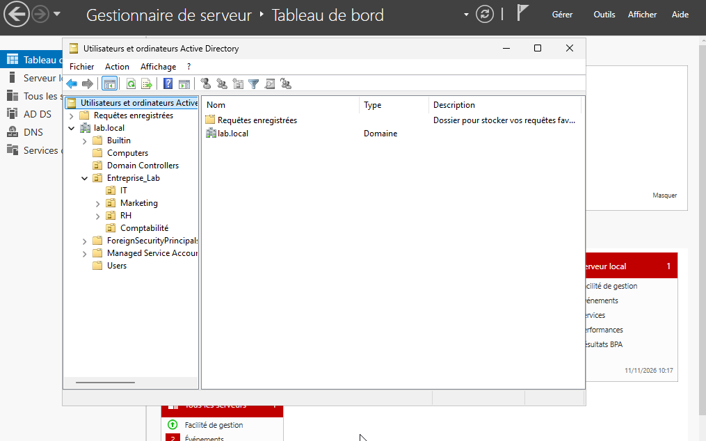

# Organisation des Unités d'Organisation (OU)

## 1. Objectif

Structurer l'annuaire Active Directory de l'entreprise TechCorp en créant une hiérarchie d'Unités d'Organisation (OU) reflétant les services de l'entreprise.

## 2. Contexte technique

Le domaine `lab.local` a été créé. Pour simuler un environnement réel, nous avons défini une arborescence.

## 3. Configuration réalisée

L'arborescence suivante a été mise en place :

*   **OU Principale** : `Entreprise_Lab`
    *   **Sous-OU** : `IT` (Informatique)
    *   **Sous-OU** : `RH` (Ressources Humaines)
    *   **Sous-OU** : `Marketing`
    *   **Sous-OU** : `Comptabilité`

## 4. Procédure de création (Exemple avec l'OU Comptabilité)

1. Ouverture de la console **Utilisateurs et ordinateurs Active Directory**.
2. Clic droit sur l'OU `Entreprise_Lab` > **Nouveau** > **Unité d'organisation**.
3. Saisie du nom `Comptabilité`.
4. Validation avec l'option de protection contre la suppression accidentelle cochée.

## 5. Captures d'écran

**Figure 1 — Structure globale des OU (arborescence dépliée)**

## 6. Résultat obtenu

L'annuaire possède désormais une structure hiérarchique claire permettant de séparer les services et de préparer l'application de stratégies futures.