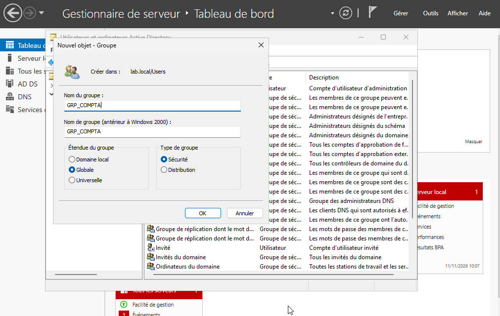
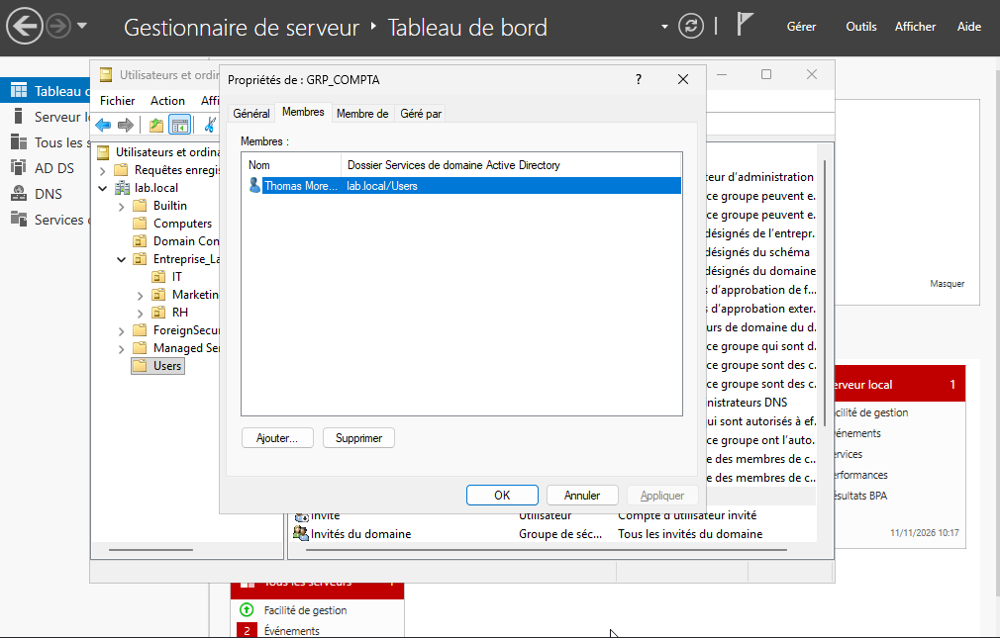

# Groupes de sécurité

## 1. Objectif

La gestion des autorisations dans Active Directory repose fortement sur les groupes de sécurité. L'objectif de cette étape est de regrouper les utilisateurs selon leur service ou leur rôle afin de simplifier l'attribution des droits et d'appliquer le principe du moindre privilège.

## 2. Contexte technique

Une fois les unités d'organisation créées, il est nécessaire d'associer les utilisateurs à des groupes de sécurité cohérents. Cela permet ensuite de gérer les autorisations sur les ressources, les dossiers partagés, les services ou les objets AD sans avoir à configurer chaque droit individuellement.

## 3. Configuration réalisée

Les groupes de sécurité suivants ont été créés :

| Nom du groupe | OU de rattachement | Membres |
| :--- | :--- | :--- |
| `GRP_IT` | `IT` | Lucas Bernard (`lbernard`) |
| `GRP_RH` | `RH` | Jean Dupont (`jdupont`) |
| `GRP_Marketing` | `Marketing` | Sarah Martin (`smartin`) |
| `GRP_Compta` | `Comptabilité` | Thomas Moreau (`tmoreau`) |

## 4. Justification du choix

Les groupes de sécurité sont un mécanisme fondamental en AD. Ils permettent de :

- centraliser la gestion des accès ;
- réduire les erreurs humaines liées aux permissions individuelles ;
- faciliter les changements de responsabilités au sein de l'entreprise ;
- sécuriser les ressources en limitant les privilèges au strict nécessaire.

En pratique, un groupe agit comme un conteneur d'utilisateurs ou d'ordinateurs auquel on attribue ensuite des droits.

## 5. Procédure de création (exemple : `GRP_Compta`)

1. Ouvrir la console **Utilisateurs et ordinateurs Active Directory**.
2. Sélectionner l'OU `Comptabilité`.
3. Cliquer avec le bouton droit > **Nouveau** > **Groupe**.
4. Saisir le nom du groupe : `GRP_Compta`.
5. Définir la portée sur **Globale** et le type sur **Sécurité**.
6. Valider la création.
7. Ouvrir les propriétés du groupe.
8. Aller dans l'onglet **Membres** puis cliquer sur **Ajouter**.
9. Ajouter le compte `tmoreau`.
10. Valider la modification.

Cette procédure est reproductible pour chaque équipe ou service de l'entreprise, ce qui permet de standardiser la sécurité dans l'annuaire.

## 6. Captures d'écran

**Figure 1 — Création du groupe de sécurité dans l'OU Comptabilité**

**Figure 2 — Ajout du membre Thomas Moreau au groupe de sécurité**

## 7. Résultat obtenu

Les utilisateurs sont désormais associés à des groupes de sécurité adaptés à leur service. Cela permet d'initier la logique de gestion des permissions au niveau du domaine, avant d'aller plus loin vers les accès aux fichiers, partages, services et contrôles d'administration.

## 8. Conclusion

La mise en place de groupes de sécurité est une étape clé dans la mise en œuvre d'un environnement Active Directory sécurisé. Elle réduit la complexité de gestion des autorisations et renforce le modèle de contrôle d'accès au sein de l'entreprise.