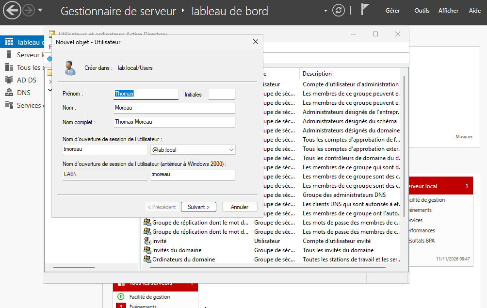

# Gestion des utilisateurs

[Accueil du laboratoire](../README.md) · [Accueil du dépôt](../../README.md)

## 1. Objectif

Cette étape consiste à créer les comptes utilisateur de l'entreprise TechCorp et à les rattacher aux bonnes unités d'organisation. Le but est de représenter un environnement de production réaliste au sein de l'annuaire Active Directory, tout en appliquant une logique de gestion cohérente pour les identités et les accès.

## 2. Contexte technique

Après la mise en place du domaine et la définition de la hiérarchie des OU, il est nécessaire d'ajouter les comptes correspondants aux services de l'organisation. Chaque compte doit être associé à une OU dédiée afin de faciliter la gestion administrative et la mise en oeuvre des politiques de sécurité.

## 3. Configuration réalisée

Les comptes suivants sont mentionnés dans les notes du laboratoire :

| Nom complet | Identifiant (Login) | OU de rattachement | Service |
| :--- | :--- | :--- | :--- |
| Lucas Bernard | `lbernard` | `IT` | IT |
| Sarah Martin | `smartin` | `Marketing` | Marketing |
| Jean Dupont | `jdupont` | `RH` | RH |
| Thomas Moreau | `tmoreau` | `Comptabilité` | Comptabilité |

La capture de création de Thomas Moreau indique `lab.local/Users` comme emplacement et non l’OU `Comptabilité` annoncée. Les captures ne permettent pas de vérifier individuellement le placement des quatre comptes ; le tableau décrit l’organisation visée dans les notes et doit être rapproché de l’annuaire réel.

## 4. Justification de la méthode

L'administration d'un domaine Active Directory repose sur l'identité. Il est essentiel de donner à chaque utilisateur :

- un compte unique,
- un identifiant explicite,
- un rattachement logique à un service,
- un mot de passe initial correctement géré,
- un statut actif adapté à la situation.

Cette logique permet d'éviter les comptes inutilisés, les erreurs d'organisation et les difficultés de gestion lors des audits de sécurité.

## 5. Procédure de création (exemple : Thomas Moreau)

1. Ouvrir la console **Utilisateurs et ordinateurs Active Directory**.
2. Sélectionner l’OU `Comptabilité` avant de lancer l’assistant. La capture actuelle montre au contraire le conteneur par défaut `Users` ; le placement de l’objet doit donc être contrôlé.
3. Cliquer avec le bouton droit > **Nouveau** > **Utilisateur**.
4. Saisir les informations du compte :
   - prénom : `Thomas`
   - nom : `Moreau`
   - nom d'ouverture de session : `tmoreau`
5. Définir un mot de passe initial conforme à la politique du laboratoire.
6. Valider la création du compte.
7. Vérifier l’état du compte dans ses propriétés avant tout test ; la capture conservée ne montre pas ce paramètre.
8. Ne modifier l’état actif/désactivé que si cela correspond au besoin du laboratoire et à la procédure autorisée.

Cette étape doit être répétée pour chaque nouvel employé, en suivant les mêmes bonnes pratiques de gestion des identités.

## 6. Captures d'écran

**Figure 1 — Création du compte utilisateur Thomas Moreau**

**Figure 2 — Propriétés du compte Thomas Moreau**

## 7. Résultat obtenu

La capture confirme l’existence de l’objet Thomas Moreau, mais pas son placement dans l’OU attendue. Les autres comptes et leur rattachement sont rapportés dans les notes, sans preuve individuelle complète dans les captures conservées. Vérifier les emplacements et l’état des comptes dans AD avant d’affirmer que la structure est conforme.

## 8. Conclusion

La gestion des utilisateurs est une étape fondamentale dans la préparation d'un environnement AD sécurisé. Elle permet non seulement d'identifier les employés, mais aussi de structurer les services, d'optimiser les autorisations et d'aligner l'annuaire sur l'organisation réelle de l'entreprise.

[OU](organizational-units.md) · [Groupes](security-groups.md) · [Retour à l’index](../README.md)