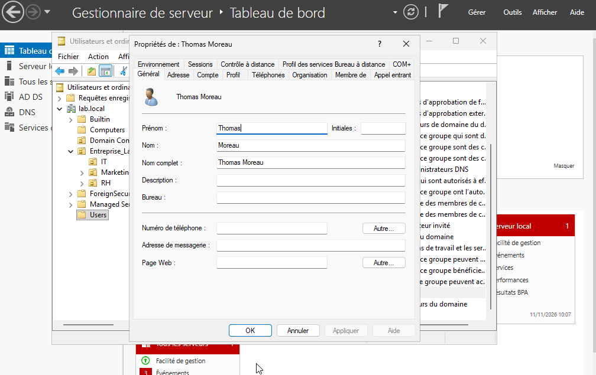

# Gestion des Utilisateurs

## 1. Objectif

Créer les comptes utilisateurs des employés et les placer dans leurs Unités d'Organisation respectives.

## 2. Configuration réalisée

Voici la liste des comptes utilisateurs actuellement dans le domaine :

| Nom complet | Identifiant (Login) | OU de rattachement | Service |
| :--- | :--- | :--- | :--- |
| Lucas Bernard | `lbernard` | `IT` | IT |
| Sarah Martin | `smartin` | `Marketing` | Marketing |
| Jean Dupont | `jdupont` | `RH` | RH |
| Thomas Moreau | `tmoreau` | `Comptabilité` | Comptabilité |

## 3. Procédure de création (Exemple avec Thomas Moreau)

1. Clic droit sur l'OU `Comptabilité` > **Nouveau** > **Utilisateur**.
2. Saisie des informations :
   * Prénom : `Thomas`
   * Nom : `Moreau`
   * Nom d'ouverture de session : `tmoreau`
3. Définition d'un mot de passe initial.
4. Vérification de l'état du compte : **Attention**, par défaut le compte peut être désactivé (icône avec une flèche bleue). Il faut aller dans l'onglet "Compte" et décocher "Le compte est désactivé".

## 4. Captures d'écran

**Figure 1 — Liste des utilisateurs dans la console AD**

**Figure 2 — Propriétés du compte de Thomas Moreau**

## 5. Résultat obtenu

Les identités numériques des collaborateurs sont centralisées. Les tests de connexion sur le client Windows 10 (CLIENT-W10) ont été validés avec succès.