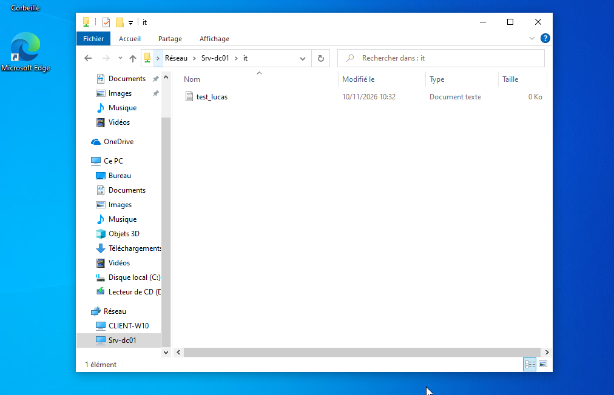
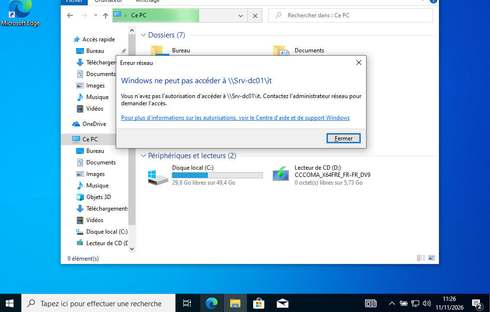

# Validation des permissions d'accès

## 1. Objectif

Le but de cette validation est de confirmer que les droits d'accès au partage réseau `\\SRV-DC01\IT` sont correctement appliqués et respectent le principe du moindre privilège. La vérification doit démontrer que :

- les utilisateurs du service informatique sont autorisés à accéder au dossier partagé ;
- les utilisateurs d'autres départements n'ont pas accès à cette ressource ;
- la logique de contrôle d'accès centralisée dans Active Directory est bien effective.

## 2. Contexte technique

L'environnement de test est composé du contrôleur de domaine `SRV-DC01` et du poste client `CLIENT-W10`, appartenant au domaine `lab.local`. Les tests sont exécutés à partir d'un compte utilisateur standard, ce qui permet de reproduire un scénario d'accès réel dans un environnement d'entreprise.

Les deux comptes utilisés pour la validation sont :

- `lab\smartin` — Sarah Martin, membre du service Marketing ;
- `lab\lbernard` — Lucas Bernard, membre du service IT.

## 3. Modèle de sécurité appliqué

Le partage `IT` a été configuré avec une logique stricte :

- le groupe `GRP_IT` reçoit les droits nécessaires sur le partage ;
- le groupe `GRP_IT` est l'unique groupe autorisé à accéder au dossier ;
- les permissions NTFS et SMB ont été définies pour éviter toute ouverture involontaire par un autre service.

Cette configuration vise à garantir la confidentialité des ressources informatiques et à limiter les risques de fuite de données ou d'accès non autorisé.

## 4. Procédure de test

1. Déconnecter la session active sur `CLIENT-W10`.
2. Se connecter avec le compte `lab\smartin`.
3. Ouvrir l'explorateur Windows.
4. Tenter d'accéder au chemin UNC `\\SRV-DC01\IT`.
5. Observer et noter le comportement système.
6. Se déconnecter puis se reconnecter avec le compte `lab\lbernard`.
7. Répéter la tentative d'accès au même chemin UNC.
8. Vérifier si l'utilisateur peut ouvrir le dossier et créer un fichier de test.

## 5. Résultats observés

| Utilisateur | Service | Résultat attendu | Résultat observé | Conclusion |
| :--- | :--- | :--- | :--- | :--- |
| `lab\smartin` | Marketing | Refus d'accès | Accès refusé | Correct |
| `lab\lbernard` | IT | Accès autorisé | Accès autorisé | Correct |

### Analyse détaillée

- Le compte `lab\smartin` ne dispose pas des autorisations nécessaires sur le partage réseau. Le système a refusé l'accès, ce qui confirme que les permissions sont bien appliquées au niveau du partage et des droits NTFS.
- Le compte `lab\lbernard`, membre du groupe `GRP_IT`, a pu accéder au dossier partagé et effectuer une action d'écriture. Cela valide la bonne configuration des droits de sécurité et de partage.

## 6. Captures d'écran

**Figure 1 — Accès autorisé pour Lucas Bernard (service IT)**

**Figure 2 — Accès refusé pour Sarah Martin (service Marketing)**

## 7. Interprétation de la mise en œuvre

Ces tests montrent que les autorisations ne sont pas seulement théoriques : elles sont réellement appliquées dans le système. La séparation des accès entre départements est donc effective, ce qui est essentiel pour sécuriser les ressources internes de l'entreprise.

Ce type de validation est particulièrement important en environnement de production, car il permet de confirmer que les permissions ne dépendent pas seulement de la structure AD, mais qu'elles sont effectivement respectées lors des accès réseau.

## 8. Résultat obtenu

Le cloisonnement de données est bien fonctionnel. Le service IT dispose des droits nécessaires au bon fonctionnement de son espace de travail partagé, tandis que les autres services ne peuvent pas accéder aux ressources informatiques sensibles.

## 9. Difficultés rencontrées

Une difficulté de cache d'authentification a été observée sur le poste client pendant les premiers essais. Le problème a été résolu en redémarrant le client Windows 10 afin de forcer la mise à jour des informations d'authentification Kerberos et des jetons de session.

## 10. Conclusion

Cette validation confirme la pertinence de la mise en place d'Active Directory comme mécanisme centralisé de gestion des droits. Les groupes de sécurité, associés aux permissions NTFS et SMB, permettent d'adopter un modèle d'accès robuste, lisible et facilement auditable, conforme aux bonnes pratiques de sécurité informatique.