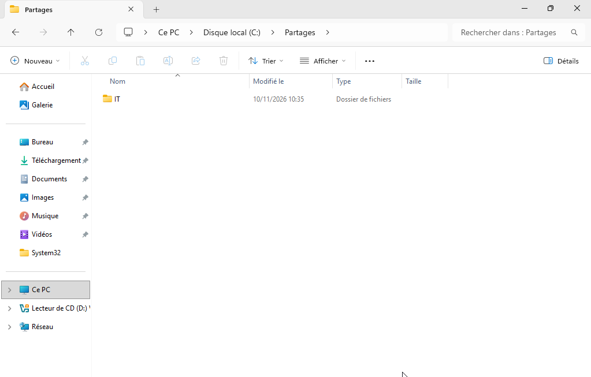
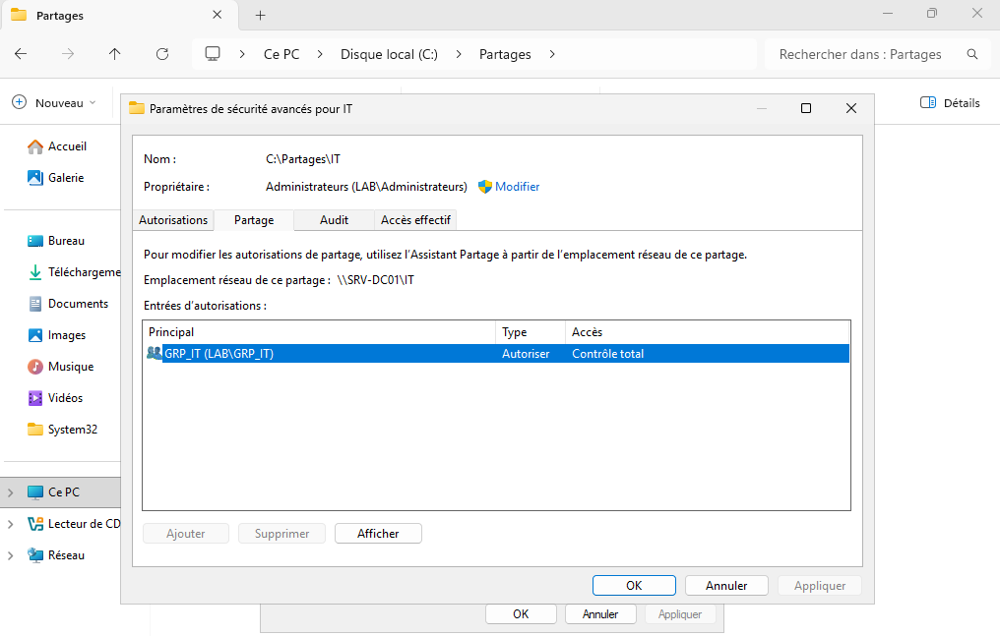
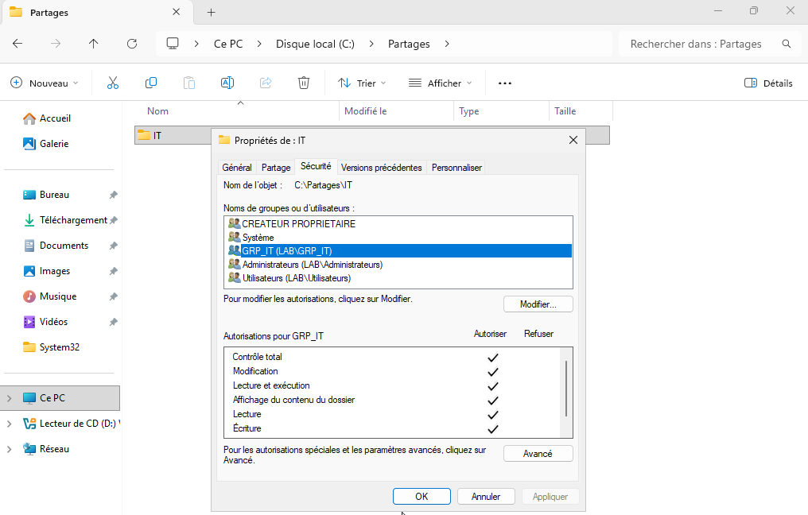

# Création et sécurisation d'un partage réseau

## 1. Objectif

Cette étape vise à mettre en place un espace de stockage réseau dédié au service informatique de TechCorp, tout en limitant strictement l'accès à ce dossier aux seuls utilisateurs autorisés. Le partage est conçu pour refléter un cas d'usage réaliste d'administration système, avec un contrôle d'accès basé sur les groupes Active Directory.

## 2. Contexte technique

Le serveur `SRV-DC01` héberge le contrôleur de domaine de l'entreprise. Une structure de fichiers a été préparée sur le disque système afin d'accueillir des ressources partagées destinées aux équipes internes. Le groupe de sécurité `GRP_IT` a été utilisé comme support principal de gestion des droits.

Le partage est destiné à l'équipe informatique et doit rester inaccessible aux autres services, en particulier au service Marketing.

## 3. Configuration réalisée

| Élément | Valeur |
| :--- | :--- |
| Dossier physique | `C:\Partages\IT` |
| Partage réseau UNC | `\\SRV-DC01\IT` |
| Groupe autorisé | `GRP_IT` |
| Partage SMB | Sécurisé, accès limité au groupe `GRP_IT` |
| Permissions NTFS | `Modification` et `Écriture` pour le groupe `GRP_IT` |
| Groupe par défaut supprimé | `Everyone` |

La suppression du groupe `Everyone` est un choix de sécurité important. En effet, ce type d'autorisation permettrait à des utilisateurs non explicitement autorisés d'essayer d'accéder au partage, ce qui est contraire au principe du moindre privilège.

## 4. Justification de la configuration

Le partage réseau ne doit pas être traité uniquement comme un simple dossier accessible depuis le réseau. Il s'agit d'un objet de sécurité qui doit intégrer :

- une mise en place de permissions de partage robuste ;
- une gestion NTFS adaptée aux besoins de lecture/écriture ;
- une logique de groupe de sécurité claire ;
- une séparation stricte entre les services.

En pratique, les permissions NTFS et SMB ne servent pas à la même étape :

- les permissions de partage contrôlent l'accès via le réseau ;
- les permissions NTFS contrôlent l'accès physique et logique sur le système de fichiers.

Les deux doivent être correctement alignées pour garantir un modèle de sécurité cohérent.

## 5. Procédure de mise en place

1. Créer le dossier `IT` dans `C:\Partages\`.
2. Ouvrir les propriétés du dossier.
3. Accéder à l'onglet **Partage**.
4. Cliquer sur **Partage avancé** puis sur **Autorisations**.
5. Supprimer le groupe `Everyone` pour éviter tout accès non autorisé.
6. Ajouter le groupe `GRP_IT` avec le niveau **Contrôle total** au niveau du partage.
7. Ouvrir l'onglet **Sécurité** du dossier.
8. Ajouter le groupe `GRP_IT`.
9. Définir les droits NTFS nécessaires, notamment **Modification** et **Écriture**.
10. Vérifier que les accès sont bien restreints au groupe informatique.

## 6. Vérifications de configuration

Avant de tester les droits par le client, il est important de vérifier que :

- le dossier est bien accessible via le chemin UNC ;
- les autorisations de partage sont limitées à `GRP_IT` ;
- les droits NTFS correspondent aux besoins opérationnels ;
- aucun accès implicite n'est laissé à des groupes mal définis.

## 7. Captures d'écran

**Figure 1 — Dossier partagé `IT` sur le serveur**

**Figure 2 — Permissions de partage SMB configurées pour le groupe IT**

**Figure 3 — Permissions NTFS appliquées au dossier partagé**

## 8. Résultat obtenu

Le partage `\\SRV-DC01\IT` est désormais disponible et protégé. Seuls les utilisateurs appartenant au groupe `GRP_IT` peuvent accéder au dossier de manière conforme aux exigences de sécurité du lab.

## 9. Difficultés rencontrées et points de vigilance

La principale difficulté lors de la configuration a été de distinguer les permissions de partage (SMB) et les permissions NTFS :

- une mauvaise configuration SMB pourrait autoriser l'accès au réseau sans donner les droits de fichier ;
- une mauvaise configuration NTFS pourrait laisser des droits trop larges ou trop restrictifs.

Il est donc essentiel de valider les deux niveaux de sécurité afin d'éviter les écarts entre autorisation réseau et autorisation locale.

## 10. Conclusion

La création d'un partage sécurisé est une étape fondamentale dans un environnement Active Directory. En associant les permissions à des groupes de sécurité et en appliquant des règles strictes sur le système de fichiers, il est possible de mettre en place un modèle de stockage fiable, lisible et adapté à la sécurité d'entreprise.