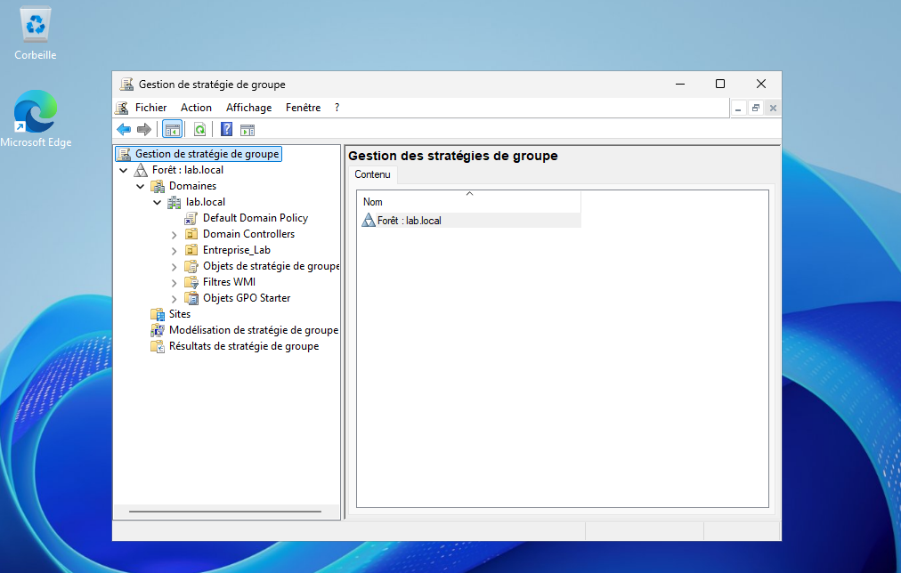
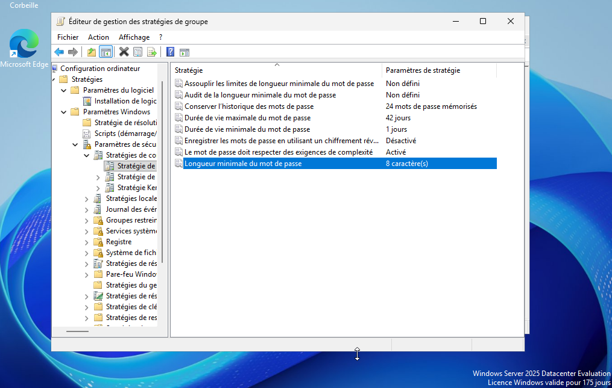
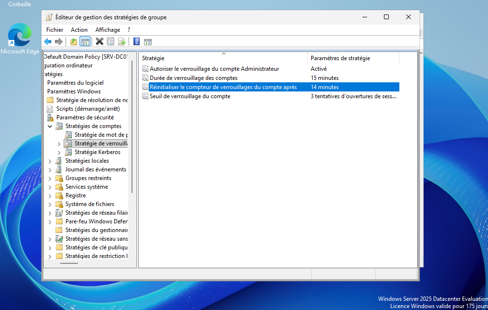
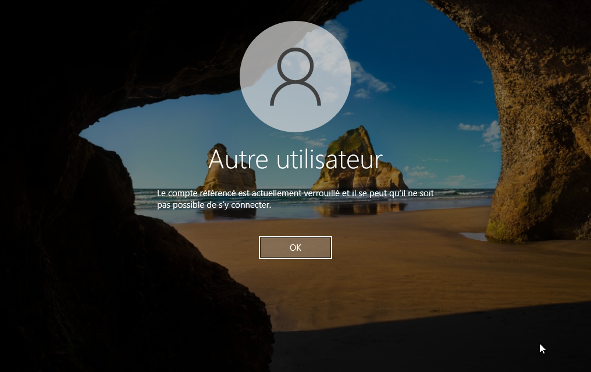

# Implémentation des Stratégies de Groupe (GPO)

[Accueil du laboratoire](../README.md) · [Accueil du dépôt](../../README.md)

## 1. Objectif

Centraliser et renforcer la sécurité du domaine `lab.local` en appliquant des stratégies de mot de passe et de verrouillage de compte via les Group Policy Objects (GPO).

## 2. Contexte technique

Cette étape documente des stratégies de mot de passe et de verrouillage configurées dans le laboratoire. Aucune valeur antérieure de la politique n’est archivée ; la configuration est présentée à partir des captures, sans généraliser sur les valeurs par défaut de Windows Server.

## 3. Configuration réalisée

Les captures de l’éditeur montrent les paramètres suivants dans la **Default Domain Policy**. Les stratégies de compte liées au domaine définissent la politique des comptes du domaine ; elles ne signifient pas que chaque paramètre s’applique indistinctement à tous les ordinateurs et utilisateurs.

| Paramètre visible | Valeur |
|---|---:|
| Longueur minimale du mot de passe | 8 caractères |
| Exigences de complexité | Activées |
| Historique des mots de passe | 24 |
| Durée de vie maximale | 42 jours |
| Durée de vie minimale | 1 jour |
| Stockage réversible du mot de passe | Désactivé |
| Seuil de verrouillage | 3 tentatives |
| Durée du verrouillage | 15 minutes |
| Réinitialisation du compteur de verrouillage | 14 minutes |

La capture indique 14 minutes pour la réinitialisation du compteur, et non 15 comme le texte antérieur. Ces valeurs sont celles visibles dans les captures ; la configuration résultante sur le client doit être vérifiée séparément.

## 4. Procédure

1. Ouverture de la console **Gestion des stratégies de groupe** (GPMC).
2. Édition de la **Default Domain Policy**.
3. Navigation vers : `Configuration ordinateur` > `Stratégies` > `Paramètres Windows` > `Paramètres de sécurité` > `Stratégies de compte`.
4. Configuration des stratégies de mot de passe et de verrouillage.
5. Actualiser la stratégie sur le poste concerné, par exemple avec `gpupdate /force`, puis vérifier la stratégie résultante et la portée d’application depuis le client.

## 5. Vérifications et Tests

Le test est rapporté comme réalisé depuis le poste client `CLIENT-W10` :
1. Une capture du client montre un compte verrouillé après des tentatives de connexion échouées.
2. **Résultat visible** : Windows indique que le compte est actuellement verrouillé. La capture ne dit pas « compte désactivé » et ne remplace pas la vérification des paramètres résultants ni l’horodatage du verrouillage.

## 6. Captures d'écran

**Figure 1 — Console de gestion des stratégies de groupe (GPMC)**

**Figure 2 — Configuration de la politique de mot de passe**

**Figure 3 — Configuration de la politique de verrouillage**

**Figure 4 — Test de verrouillage réussi sur le client Windows 10**

## 7. Résultat obtenu

Les captures documentent les paramètres de mot de passe et de verrouillage ainsi qu’un écran de compte verrouillé. Elles ne démontrent pas à elles seules la robustesse réelle des mots de passe ni l’application de ces valeurs à l’ensemble du domaine. Un verrouillage bas peut également provoquer une indisponibilité ; toute modification ou tout test doit être autorisé et réalisé avec un compte dédié.

## 8. Difficultés rencontrées

Le texte initial rapporte que la stratégie n’était pas immédiatement visible sur le client et qu’un redémarrage a été effectué. La cause n’est pas établie ; conserver une sortie datée de `gpresult` ou de la stratégie résultante lors de la reprise du test.

## 9. Conclusion

Les GPO sont un outil extrêmement puissant. Elles permettent d'appliquer une politique de sécurité cohérente sur des centaines de machines sans intervention manuelle. C'est un pilier de la gestion d'un Active Directory.

[Durcissement Windows Server](windows-server-hardening.md) · [Retour à l’index](../README.md)

## Références techniques

- Microsoft Learn — [Account lockout threshold](https://learn.microsoft.com/en-us/previous-versions/windows/it-pro/windows-10/security/threat-protection/security-policy-settings/account-lockout-threshold)
- Microsoft Learn — [Password Policy](https://learn.microsoft.com/en-us/previous-versions/windows/it-pro/windows-10/security/threat-protection/security-policy-settings/password-policy)