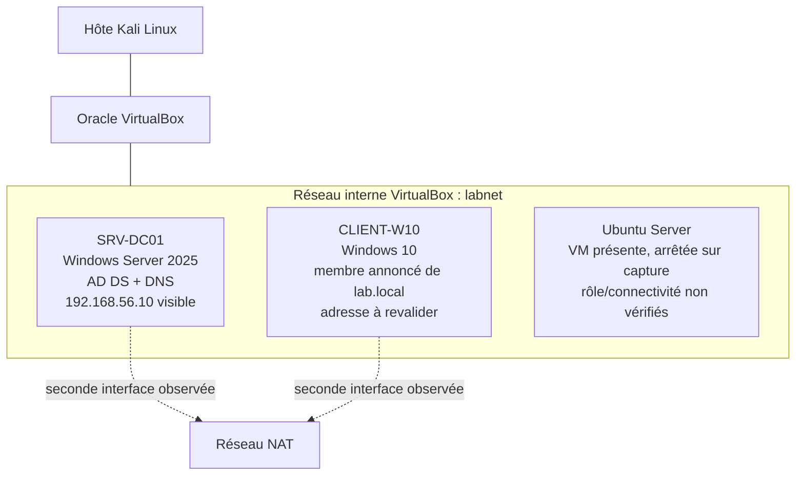

# Laboratoire Active Directory — TechCorp

Ce laboratoire unique suit le cycle de déploiement, d’organisation, de sécurisation et d’audit d’un domaine Active Directory `lab.local`. Les huit répertoires numérotés correspondent à des phases du même environnement, pas à huit laboratoires indépendants.

> **Statut général :** documentation et captures disponibles, mais les validations ne sont pas toutes concluantes. La capture `dcdiag` montre un échec de résolution DNS du nom du contrôleur. Les éléments ci-dessous distinguent la preuve visible, les déclarations du compte rendu et les vérifications restant à faire.

## Architecture documentée

Le schéma décrit les éléments documentés, pas un test de connectivité. Les captures montrent les interfaces `labnet` et NAT ; une autre capture montre l’adresse `10.0.3.15` parmi les enregistrements DNS de `SRV-DC01`. Ce point et l’échec `dcdiag` doivent être investigués avant de conclure que la résolution et la localisation du contrôleur fonctionnent.

## Parcours documentaire

| Phase | Sujet | Documents |
|---|---|---|
| 01 | Architecture | [Architecture et topologie](01-architecture/architecture.md) |
| 02 | Active Directory | [Installation AD DS](02-active-directory/adds-installation.md) |
| 03 | Gestion des identités | [OU](03-identity-management/organizational-units.md) · [Utilisateurs](03-identity-management/user-management.md) · [Groupes](03-identity-management/security-groups.md) |
| 04 | Contrôle d’accès | [Partages](04-access-control/shared-folders.md) · [Tests d’accès](04-access-control/permissions-testing.md) |
| 05 | Durcissement | [GPO](05-system-hardening/gpo-implementation.md) · [Windows Server](05-system-hardening/windows-server-hardening.md) |
| 06 | DNS | [DNSSEC](06-dns-security/dnssec-implementation.md) |
| 07 | Audit | [Méthodologie](07-security-audit/audit-methodology.md) · [Résultats](07-security-audit/audit-results.md) · [Constats](07-security-audit/security-findings.md) |
| 08 | Remédiation | [Plan d’action](08-remediation/remediation-plan.md) |

## État des preuves

| État | Signification dans ce dépôt |
|---|---|
| **Visible** | Élément lisible dans une capture ou un résultat consigné. Cela ne démontre pas nécessairement l’état actuel du système. |
| **Déclaré** | Résultat rapporté dans le texte sans sortie ou preuve indépendante suffisante. |
| **À vérifier** | Contrôle non réalisé, incomplet ou contredit par une autre preuve. |
| **Non confirmé** | Aucune vulnérabilité ne doit être inscrite comme confirmée sans validation technique reproductible. |

## Points de contrôle prioritaires

1. Rejouer les diagnostics DNS et DC locator sur `SRV-DC01` et corréler les résultats avec les enregistrements des interfaces.
2. Vérifier le placement réel des comptes et groupes par rapport aux OU annoncées.
3. Examiner les permissions effectives du partage, en particulier les entrées NTFS supplémentaires et les droits « Contrôle total ».
4. Confirmer l’application effective de la GPO sur le domaine et documenter les paramètres à partir d’une sortie datée.
5. Distinguer la signature de `lab.local` de la validation DNSSEC des clients et de l’existence d’une chaîne de confiance interne.
6. Terminer l’audit autorisé avant de publier des constats ou de clôturer le plan de remédiation.

Les commandes actives et les tests d’authentification doivent rester limités à cet environnement autorisé, être planifiés et éviter les risques de verrouillage ou d’interruption.

[Retour à l’accueil du dépôt](../README.md)
